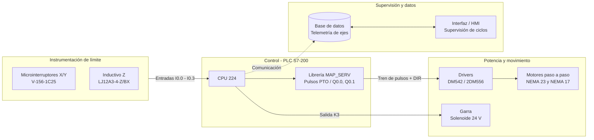

<div align="center">

# 🦾 Brazo robótico didáctico de 4 GDL (XK-JS1-1)

### Laboratorio de Control · Ingeniería Electrónica · UMSA

[](https://gabandgom.github.io/Brazo-de-4-grados-de-libertad/)
[](#arquitectura)
[](global/normativas)

**Sistemas de Control II (ETN-902)** · **Aplicación de Técnicas de Control (ETN-1034)** · **Bases de Datos (ETN-1000)**

[Descripción](#descripción) · [Arquitectura](#arquitectura) · [Estructura](#estructura-del-repositorio) · [Cómo subir archivos](#cómo-subir-archivos) · [Página web](#página-web) · [Equipo](#equipo)

</div>

---

## Descripción

El **XK-JS1-1** es un brazo manipulador didáctico de 4 grados de libertad para el entrenamiento en automatización industrial. Sus ejes X, Y y Z se mueven con motores paso a paso controlados por un PLC Siemens S7-200 (CPU 224) mediante trenes de pulsos, y el efector final es una garra accionada por solenoide de 24 V.

El sistema trabaja en **lazo abierto con supervisión discreta**: no tiene encoders, así que las referencias de posición vienen de los finales de carrera (ejes X/Y) y de un sensor inductivo (eje Z).

Este repositorio reúne la documentación del brazo y el trabajo de cada semestre: informes, guías, planos, programas de PLC, base de datos y datasheets. Todo se puede consultar en la **[página del proyecto](https://gabandgom.github.io/Brazo-de-4-grados-de-libertad/)**.

## Arquitectura



## Estructura del repositorio

```
├── global/                  Lo que es del brazo y no de un semestre
│   ├── datasheets/          PLC, drivers, sensores, finales de carrera, relés
│   ├── manuales/            Manual del XK-JS1-1 y manuales de Siemens
│   ├── normativas/          ISA S5.1 (P&ID) e IEC 60617 (simbología eléctrica)
│   ├── programas-plc/       Programa Micro/WIN del brazo y librería MAP_SERV
│   ├── componentes/         Fotos de cada componente
│   └── plantillas/          Plantilla LaTeX de informes
│
├── semestres/               El trabajo de cada gestión
│   ├── 2026_I/              Informes 1 y 2, plano eléctrico y P&ID
│   └── 2026_II/             Guías, informes, planos históricos, base de datos,
│                            programas PLC, HMI, pruebas y evidencias
│
├── config/                  Títulos, descripciones, semestres, equipo y videos de la página
├── scripts/                 Generador del catálogo de la página
├── web/                     Estilos y código de la página
└── index.html               Página principal
```

| Carpeta | Contenido |
|---|---|
| [`global/datasheets`](global/datasheets) | CPU 224 (6ES7214-1AD23), drivers Leadshine DM542 y JMC 2DM556, sensor LJ12A3-4-Z/BX, final de carrera V-156-1C25, relé NJX. |
| [`global/manuales`](global/manuales) | Manual del XK-JS1-1, referencia Ladder (KOP) y librería MAP_SERV de Siemens. |
| [`global/normativas`](global/normativas) | ISA S5.1 e IEC 60617. |
| [`global/programas-plc`](global/programas-plc) | Proyecto Micro/WIN del brazo y librerías MAP_SERV para Q0.0 y Q0.1. |
| [`semestres/2026_I`](semestres/2026_I) | Identificación de variables, simbología P&ID y esquemas eléctricos. |
| [`semestres/2026_II`](semestres/2026_II) | Semestre en curso: auditoría y requerimientos, guías de laboratorio integrado, planos históricos, base de datos e interfaz local. |

## Cómo subir archivos

Resumen rápido (los detalles están en **[CONTRIBUTING.md](CONTRIBUTING.md)**):

1. Lo de este semestre va en `semestres/2026_II/<carpeta>/`. Lo que es del brazo en general (datasheets, manuales) va en `global/`.
2. Nombres **sin tildes, sin ñ y sin espacios**: `informe_2_modelado.pdf`, `eje_z_referencia.awl`.
3. Desde GitHub: entrar a la carpeta → **Add file → Upload files** → commit en `main`. La página se actualiza sola en uno o dos minutos.
4. Para que el archivo tenga un título y una descripción bonitos en la página, agregarlo en [`config/archivos.json`](config/archivos.json) (opcional).
5. Los **videos no se suben** al repositorio: se suben a YouTube y el enlace va en [`config/videos.json`](config/videos.json).

## Página web

La página **https://gabandgom.github.io/Brazo-de-4-grados-de-libertad/** se genera sola desde este repositorio:

- En cada push a `main`, GitHub Actions ejecuta `scripts/build-catalog.js`, que recorre `global/` y `semestres/` y genera `web/data/catalogo.js`.
- La página lee ese catálogo y muestra los documentos por subsistema, semestre y categoría, los programas, la galería y un explorador de carpetas.
- PDF, imágenes, Markdown y código se abren en la misma página; los planos `.dwg` y proyectos `.mwp` se descargan.

Para verla en tu computadora:

```bash
node scripts/build-catalog.js
python3 -m http.server 8044
```

y abrir http://localhost:8044.

## Equipo

**Docente:** Ing. Jorge Antonio Nava Amador · **Auxiliares:** Limber Ajnota, Fabián Plata, Franz Choque

| Semestre | Grupo | Integrantes |
|---|---|---|
| II-2026 | Control (ETN-902 / ETN-1034) | Gabriel Andres Gomez Calla, Jose Lenin Mamani Choque, Miguel Alejandro Lima Huarachi, Román Abner Machicado Arequipa |
| II-2026 | Cómputo (ETN-1000) | Miguel Alejandro Lima Huarachi, Marco Eduardo Chura Rondo |
| I-2026 | Control (ETN-902 / ETN-1034) | Jorge Alex Arriata Paco, Gabriel Andres Gomez Calla, Domingo Fabio Layme Patzi |

---

<sub>Universidad Mayor de San Andrés · Facultad de Ingeniería · Carrera de Ingeniería Electrónica · La Paz, Bolivia</sub>
