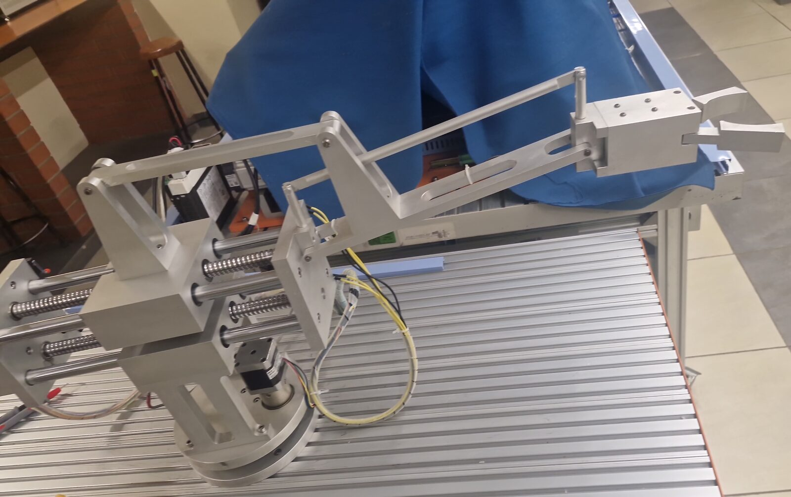
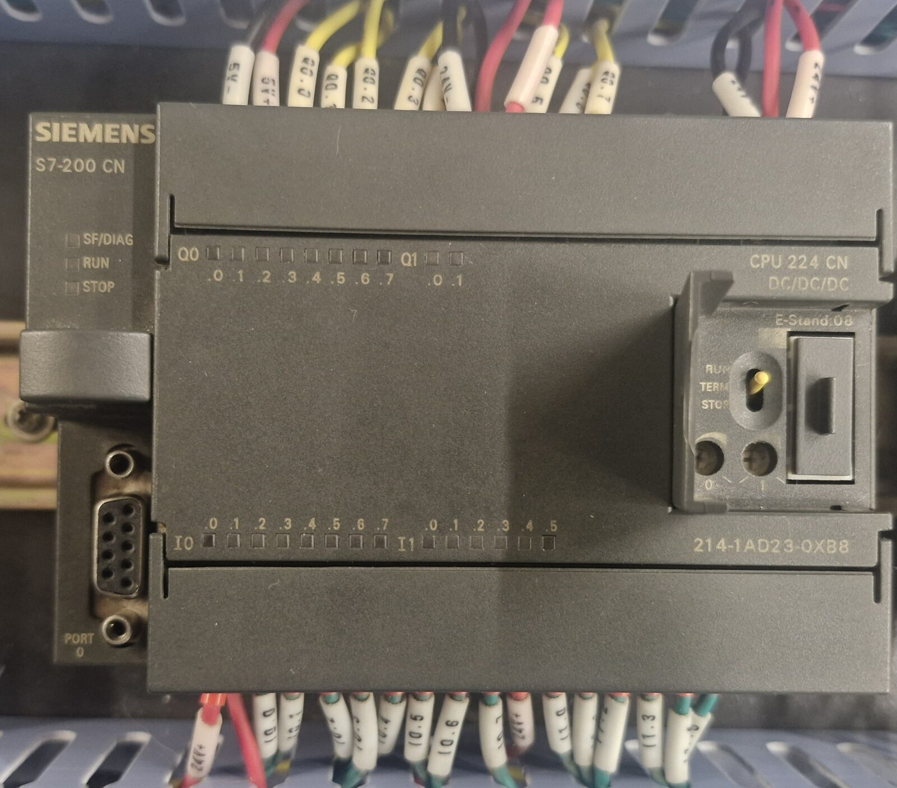
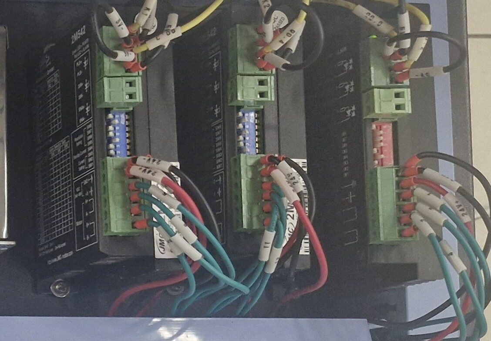
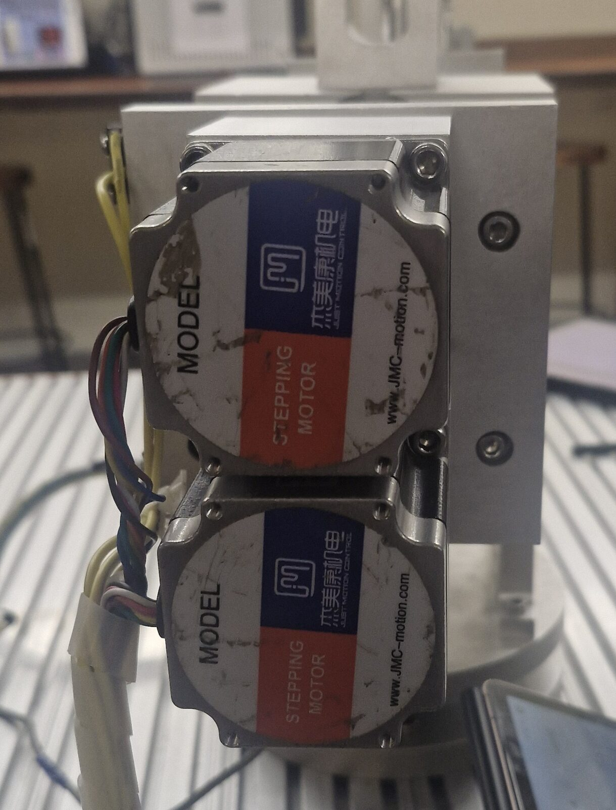
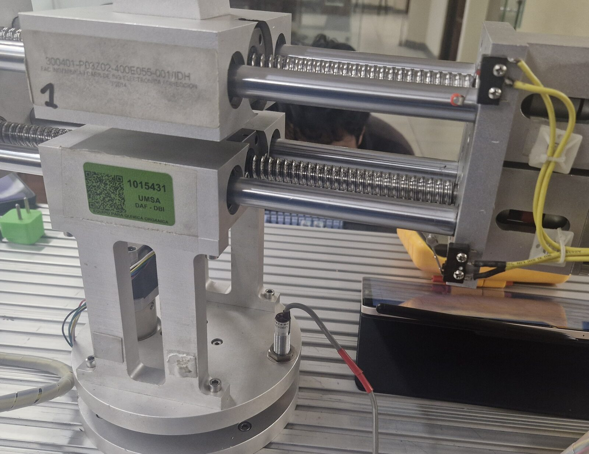
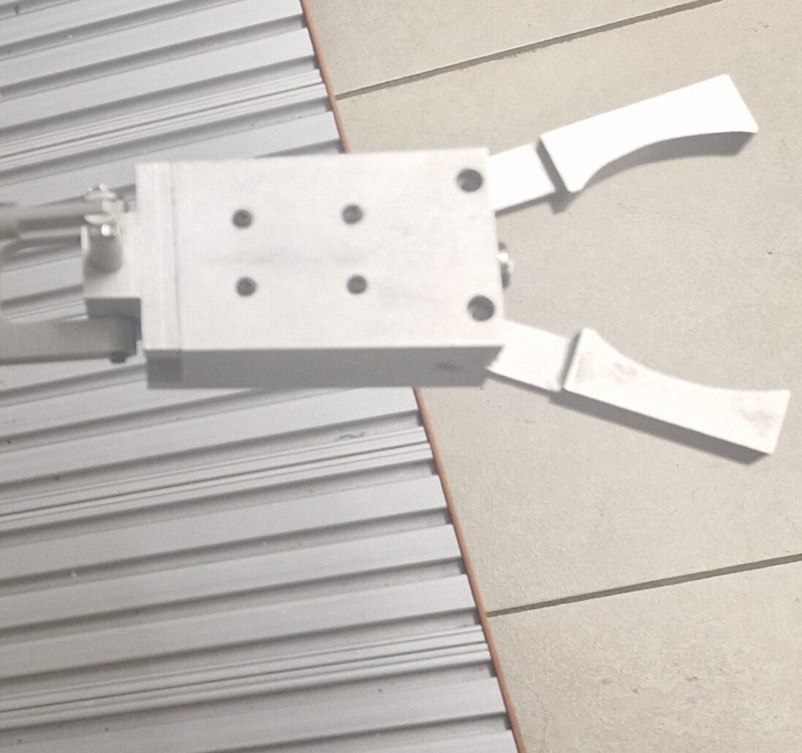
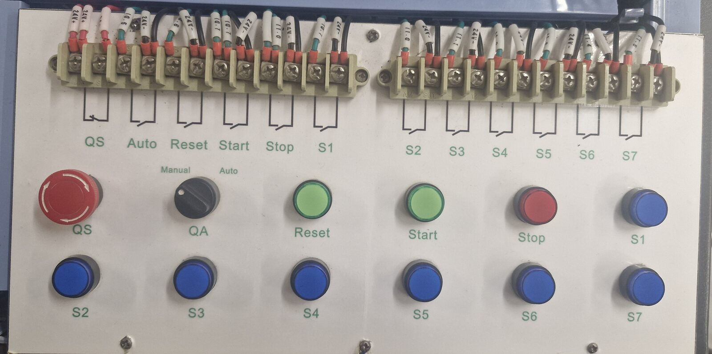
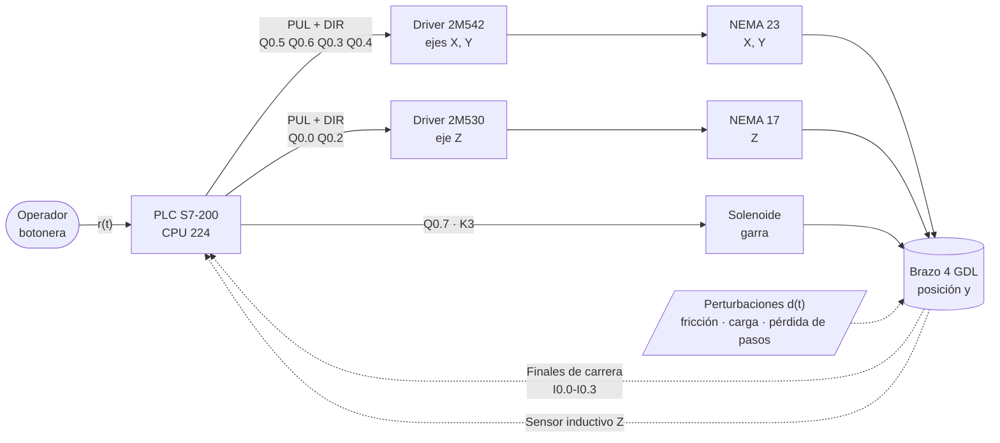
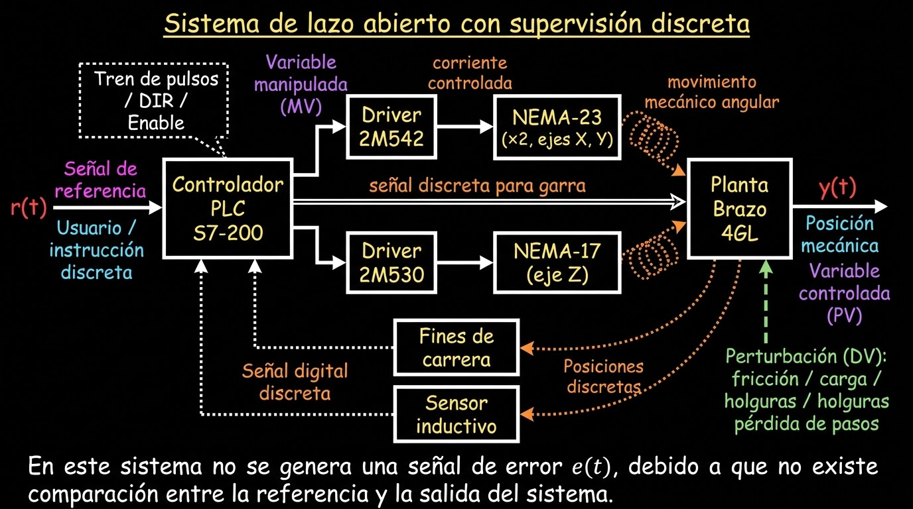
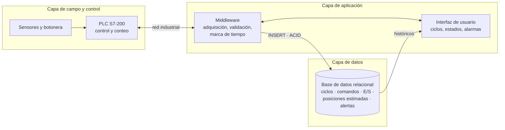

<div align="center">

# 🦾 Brazo robótico didáctico de 4 GDL · XK-JS1-1

**Laboratorio de Control · Carrera de Ingeniería Electrónica · UMSA**

Sistemas de Control II (ETN-902) · Aplicación de Técnicas de Control (ETN-1034) · Bases de Datos (ETN-1000)

[](https://brazo-4gdl.pages.dev/)
[](#ficha-técnica-del-hardware)
[](#avance-por-semestre)
[](global/normativas)



[Descripción](#descripción) ·
[Hardware](#ficha-técnica-del-hardware) ·
[E/S del PLC](#mapa-de-entradas-y-salidas) ·
[Control](#arquitectura-de-control) ·
[Datos](#arquitectura-de-datos) ·
[Avance](#avance-por-semestre) ·
[Repositorio](#estructura-del-repositorio) ·
[Equipo](#equipo)

</div>

---

## Descripción

El **XK-JS1-1** es un brazo manipulador didáctico de 4 grados de libertad: desplazamiento en los ejes **X, Y y Z** y la acción de sujeción de la **garra**. Cada eje lo mueve un motor paso a paso con su driver, comandado por un **PLC Siemens S7-200 (CPU 224)** mediante trenes de pulsos. La garra es un solenoide de 24 V accionado por relé.

El brazo **no tiene encoders**. El PLC estima la posición contando pulsos (`q_est = q0 + Np·Δq`), y solo recibe referencias discretas de los finales de carrera (X, Y) y del sensor inductivo (Z). Por eso el sistema trabaja en **lazo abierto con supervisión discreta**: la acción de control mueve el eje, pero la posición real no vuelve al controlador (`u(t) → y(t)`, pero `y(t) ↛ u(t)`).

En la gestión II/2026 el brazo es una de las cuatro plantas del **laboratorio integrado** de ETN-902, ETN-1034 y ETN-1000. El trabajo sigue el ciclo de vida del desarrollo de sistemas con mejora continua **Kaizen**. Este repositorio reúne los informes, planos, programas, datasheets y la base de datos del proyecto, que también se pueden consultar en la **[página del proyecto](https://brazo-4gdl.pages.dev/)**.

## Ficha técnica del hardware

Levantamiento por inspección física y medición pasiva (Informe 1, II-2026).

<table>
  <tr>
    <td align="center" width="33%"><br><b>PLC S7-200 CPU 224</b></td>
    <td align="center" width="33%"><br><b>Drivers 2M542 y 2M530</b></td>
    <td align="center" width="33%"><br><b>Motores NEMA 23 (X-Y)</b></td>
  </tr>
  <tr>
    <td align="center"><br><b>Eje Z y sensor inductivo</b></td>
    <td align="center"><br><b>Garra con solenoide</b></td>
    <td align="center"><br><b>Botonera de operación</b></td>
  </tr>
</table>

| # | Componente | Modelo | Datos principales | Función |
|---|---|---|---|---|
| 1 | Estructura mecánica | XK-JS1-1 | Metálica, guías lineales | Convierte el giro de los motores en desplazamiento X, Y, Z |
| 2 | PLC | Siemens S7-200 CPU 224 | 14 DI / 10 DO a 24 V DC, RS-485 (PPI), PTO hasta 20 kHz | Lógica secuencial, trenes de pulsos y mando de relés |
| 3 | Fuente | Conmutada industrial | 220 V AC → 24 V y 5 V DC | Alimentación del PLC, sensores y control |
| 4 | Disyuntor | DZ47LE-63 | 16 A, 230-400 V, fuga 30 mA, curva C | Protección general |
| 5 | Drivers | 2M542 (X, Y) · 2M530 (Z) | 20-50 V / 1.0-4.2 A · 18-50 V / 0.5-3.0 A | Entradas PUL, DIR, ENA optoacopladas; microstepping |
| 6 | Motores X, Y | NEMA 23 · 57J1854-828 | 24-48 V DC, 2.8 A, 1.8°/paso | Movimiento de los ejes X e Y |
| 7 | Motor Z | NEMA 17 · 42J1848-604 | 1.2 A, 200 pasos/rev | Movimiento vertical |
| 8 | Relés | Omron MY2NJ | DPDT, bobina 24 V DC, 5 A | K1, K2 conmutan pulsos X/Y; K3 acciona la garra |
| 9 | Finales de carrera | M102-011 | NO/NC, 5 A a 250 V AC | Homing y límites de X e Y |
| 10 | Sensor inductivo | LJ12A3-4-Z/BX | NPN NA, 6-36 V DC, 4 mm, IP67 | Homing del eje Z |
| 11 | Garra | Solenoide | 24 V DC, ON/OFF | Abrir y cerrar la pinza |
| 12 | Botonera | — | Start, Stop, Reset, S1-S7, Manual/Auto (QA), general (QS) | Interfaz del operador |

Hojas de datos y manuales: [`global/datasheets`](global/datasheets) · [`global/manuales`](global/manuales) · todas las fotos en [`global/fotos-planta`](global/fotos-planta).

## Mapa de entradas y salidas

Según el vector multifase medido con multímetro (Informe 1, II-2026).

| Señal | Dirección PLC | Elemento | Tipo |
|---|---|---|---|
| Finales de carrera X/Y (LS1-LS4) | `I0.0` - `I0.3` | M102-011 | Digital NPN, 24 V |
| Botonera (QA, Reset, Start, Stop, S1-S7) | `I0.4` - `I1.5` | Panel frontal | Digital, 24 V |
| Sensor inductivo Z | Por confirmar | LJ12A3-4-Z/BX | Digital NPN, 6-36 V |
| Pulsos eje X / Y / Z | `Q0.5` / `Q0.6` / `Q0.0` | Drivers 2M542, 2M530 | Tren de pulsos |
| Dirección eje X / Y / Z | `Q0.3` / `Q0.4` / `Q0.2` | Drivers 2M542, 2M530 | Digital |
| Garra | `Q0.7` | Relé K3 → solenoide | Digital, 24 V |

> En la verificación se encontró un desfase de 1 bit en `I0.0`-`I0.3` respecto a la tabla 2-1 del manual heredado. `Q0.7` (garra) es la única señal validada por completo contra el manual.

## Arquitectura de control



<p align="center">
  <br>
  <sub>Diagrama de bloques fenomenológico: lazo abierto con supervisión discreta.</sub>
</p>

### Clasificación de variables

| Tipo | Variable | Descripción |
|---|---|---|
| **MV** | Tren de pulsos por eje (`Np`, `fp`) | `Q0.5` (X), `Q0.6` (Y), `Q0.0` (Z). Define el desplazamiento por conteo de pasos |
| **MV** | Dirección (DIR) | `Q0.3` (X), `Q0.4` (Y), `Q0.2` (Z). Sentido de giro |
| **MV** | Garra ON/OFF (`yG`) | `Q0.7`, 24 V. Activa el solenoide |
| **PV** | Posición estimada por eje (`q_est`) | No medible directamente: `q0 + Np·Δq` |
| **PV** | Estado de la garra | Inferido del nivel de `Q0.7` |
| **PV discreta** | Homing (`sFC`, `sIND`) | Finales de carrera y sensor inductivo; solo indican puntos fijos |
| **DV** | Fricción, carga en la garra, holguras, pérdida de pasos | No medibles; separan `q_real` de `q_est` |

## Arquitectura de datos

Propuesta cliente-servidor de 3 capas (ETN-1000). La posición almacenada es la estimada por conteo de pulsos, no una medición.



El modelo entidad-relación preliminar está en [`semestres/2026_II/base-de-datos/modelo`](semestres/2026_II/base-de-datos/modelo), y los mockups de la interfaz local en [`semestres/2026_II/base-de-datos`](semestres/2026_II/base-de-datos).

## Avance por semestre

### II-2026 (en curso)

| Laboratorio | Tema | Entregables |
|---|---|---|
| [Guía 1](semestres/2026_II/guias/guia_laboratorio_1.pdf) · [Informe 1](semestres/2026_II/informes/informe_1_auditoria_y_requerimientos.pdf) | Auditoría y levantamiento de requerimientos | Ficha técnica unificada, reporte de discrepancias Kaizen, diagrama de bloques fenomenológico, arquitectura de datos y modelo E-R preliminar |
| [Guía 2](semestres/2026_II/guias/guia_laboratorio_2.pdf) | Semanas 3 y 4 (18 ago - 1 sep) | Mockups y organigrama del sistema (ETN-1000) |
| [Guía 3](semestres/2026_II/guias/guia_laboratorio_3.pdf) | Semanas 5 y 6 (1 - 15 sep) | En curso |

**Discrepancias Kaizen** encontradas entre el plano histórico y la planta real:

1. Pines de E/S del PLC activos que el plano no dibuja.
2. Conexión del solenoide de la garra (K3) dibujada de forma incorrecta.
3. Pin DIR+ del driver 2M542 del eje X no aparece en el plano.
4. Pin DIR+ del driver 2M542 del eje Y no aparece en el plano.
5. Desfase de 1 bit en las direcciones de los finales de carrera `I0.0`-`I0.3`.
6. El diseño no documenta la ausencia de encoders: el sistema opera en lazo abierto.

En el mantenimiento preventivo se resoldaron conexiones de los finales de carrera, se protegieron con termocontraíble y se aseguraron las borneras. Las pruebas funcionales posteriores fueron correctas.

### I-2026

| Laboratorio | Tema |
|---|---|
| [Informe 1](semestres/2026_I/informes/informe_1_identificacion_de_variables.pdf) | Identificación de variables y sistemas del brazo |
| [Informe 2](semestres/2026_I/informes/informe_2_simbologia_pid_y_esquemas.pdf) | Simbología P&ID (ISA S5.1) y esquemas eléctricos (IEC 60617). Planos en [`semestres/2026_I/planos`](semestres/2026_I/planos) |

## Estructura del repositorio

```
├── global/                   Lo que es del brazo y no de un semestre
│   ├── fotos-planta/         Fotos reales de cada componente (II-2026)
│   ├── componentes/          Fotos de componentes (I-2026)
│   ├── datasheets/           PLC, drivers, sensores, finales de carrera, relés
│   ├── manuales/             Manual XK-JS1-1, Ladder (KOP) y MAP_SERV de Siemens
│   ├── normativas/           ISA S5.1 e IEC 60617
│   ├── programas-plc/        Proyecto Micro/WIN del brazo y librerías MAP_SERV
│   └── plantillas/           Plantilla LaTeX de informes
│
├── semestres/
│   ├── 2026_I/               informes/ · planos/electrico · planos/pid
│   └── 2026_II/              guias/ · informes/ · planos/ · diagramas/ ·
│                             base-de-datos/ · programas-plc/ · hmi/ ·
│                             pruebas/ · evidencias/
│
├── config/                   Títulos, descripciones, semestres, equipo y videos de la página
├── scripts/build-catalog.js  Genera el catálogo de la página
├── web/                      Estilos, código e imágenes de la página
├── index.html                Página principal
└── .github/workflows/        Publicación alternativa en GitHub Pages
```

## Cómo subir archivos

La guía completa está en **[CONTRIBUTING.md](CONTRIBUTING.md)**. En resumen:

1. Lo de este semestre va en `semestres/2026_II/<carpeta>/`. Lo que es del brazo en general va en `global/`.
2. Nombres **sin tildes, sin ñ y sin espacios**: `informe_2_modelado.pdf`, `eje_z_homing.awl`.
3. En GitHub: entrar a la carpeta → **Add file → Upload files** → commit en `main`. La página se actualiza sola en uno o dos minutos.
4. Para darle título y descripción en la página, agregarlo en [`config/archivos.json`](config/archivos.json).
5. Los videos van a YouTube (no listados), y el enlace en [`config/videos.json`](config/videos.json).

## Página web

**https://brazo-4gdl.pages.dev/**

Está alojada en **Cloudflare Pages** (gratis). En cada push a `main`, Cloudflare clona el repositorio, ejecuta `node scripts/build-catalog.js` (que recorre `global/` y `semestres/` y genera el catálogo) y publica el sitio en uno o dos minutos. El estado de cada despliegue aparece junto al commit en GitHub. La página muestra la ficha técnica con fotos, los documentos por subsistema, semestre y categoría, los programas, una galería y un explorador de carpetas. PDF, imágenes, Markdown y código se abren ahí mismo.

> Cloudflare no publica archivos de más de 25 MB: si se sube uno, la página lo descarga directamente desde GitHub.

Para verla en tu computadora:

```bash
node scripts/build-catalog.js && python3 -m http.server 8044
```

## Equipo

**Docente:** Ing. Jorge Antonio Nava Amador · **Auxiliares de docencia:** Limber Ajnota, Fabián Plata, Franz Choque

| Gestión | Equipo | Integrantes |
|---|---|---|
| II-2026 | Control (ETN-902 / ETN-1034) | Gabriel Andres Gomez Calla · Jose Lenin Mamani Choque · Miguel Alejandro Lima Huarachi · Román Abner Machicado Arequipa |
| II-2026 | Cómputo (ETN-1000) | Miguel Alejandro Lima Huarachi · Marco Eduardo Chura Rondo |
| I-2026 | Control (ETN-902 / ETN-1034) | Jorge Alex Arriata Paco · Gabriel Andres Gomez Calla · Domingo Fabio Layme Patzi |

---

<div align="center"><sub>Universidad Mayor de San Andrés · Facultad de Ingeniería · Carrera de Ingeniería Electrónica · La Paz, Bolivia</sub></div>
